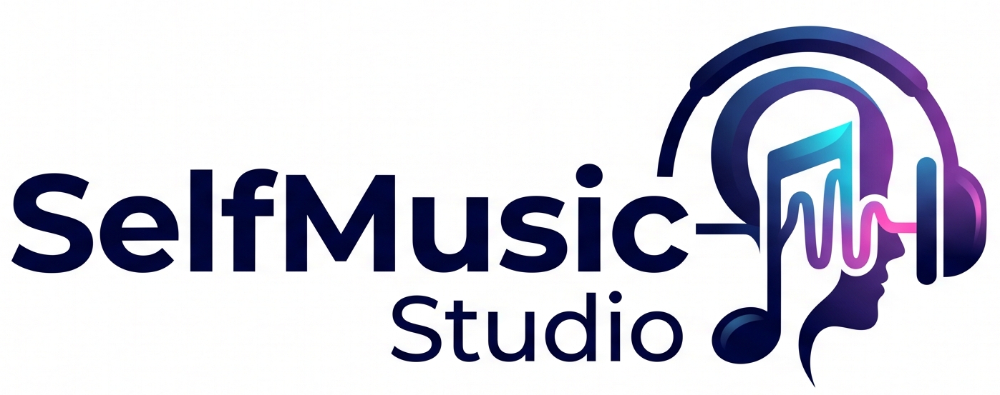

# SelfMusic Studio

Aplikasi desktop untuk membuat musik AI dengan **SunoAPI.org** dan **KIE.AI**.
Dibangun dengan Electron dan membungkus antarmuka web `SelfMusic-Studio.html`
menjadi aplikasi Windows dan Linux dengan auto-update.



## Fitur

- Generate musik (SunoAPI.org & KIE.AI)
- Upload & cover lagu
- Buat video MP4 dari lagu
- Convert audio ke WAV
- Ambil lirik
- Cek status task
- **Buat suara (TTS)** dengan banyak penyedia: ElevenLabs, OpenAI, Google Gemini,
  Google Cloud, Microsoft Azure, MiniMax, Cartesia, Fish Audio, Qwen, Deepgram,
  dan suara perangkat (gratis tanpa API key)
- **Suara perangkat offline (bawaan paket)**: eSpeak NG + Piper neural untuk
  Bahasa Indonesia, tanpa internet dan tanpa API key. Hasilnya berupa berkas WAV
  sehingga **bisa disimpan** seperti penyedia lain
- **Clone suara** dari unggahan file atau rekaman mikrofon, plus gaya bicara
  (netral, semangat, bercerita, tenang, ramah)
- **Pustaka suara** untuk menyimpan dan memakai ulang hasil clone
- **Simpan hasil suara ke komputer**: tombol `Simpan suara` membuka dialog simpan
  native (pilih folder mana pun), plus `Buka folder` untuk membuka lokasinya.
  Tersedia juga **simpan otomatis** ke folder terakhir tanpa dialog
- **Pengaturan sampel suara**: batas durasi min/maks, ukuran berkas, format,
  auto-pilih suara baru, auto-putar pratinjau, dan pernyataan izin
- **Tema aplikasi**: Gelap, Terang, Samudra, Senja
- **Bahasa aplikasi**: Indonesia & English
- Multi API key (beberapa key per provider, aktif/nonaktif, failover)
- Riwayat, log generate, dan log aktivitas
- Manajer unduhan native (pause, resume, cancel, buka folder)
- Auto-update via GitHub Releases

## Persyaratan

- Node.js dan npm
- Untuk build Windows di Linux dibutuhkan Wine
- `dpkg-deb` dan `apt-get` (dipakai script aset untuk membuka paket eSpeak NG
  tanpa perlu `sudo`)
- `unzip` (aset Windows) dan `wine` atau `msiextract` (untuk membuka
  `espeak-ng.msi` resmi)

## Menjalankan (development)

```sh
npm install
npm run prepare:assets   # unduh model Piper + eSpeak NG (~84 MB, sekali saja)
npm start
```

## Build

```sh
npm run build:linux     # AppImage
npm run build:linux:deb # paket .deb
npm run build:windows   # NSIS installer (.exe)
npm run build           # semuanya
```

Hasil build ditulis ke folder `dist/`.

### Aset TTS dan ukuran paket

Model Piper (~60 MB) dan data eSpeak NG (~26 MB) ikut di dalam paket supaya
pengguna tidak perlu memasang apa pun. Total paket naik dari sekitar 121 MB
menjadi sekitar 200 MB.

`resources/tts/` tidak masuk Git karena terlalu besar; `npm run prepare:assets`
mengunduhnya kembali. Build memanggil `prepare:assets --check` lebih dulu, jadi
build gagal dengan pesan jelas kalau asetnya belum ada. Build Windows memakai
`prepare:assets:check --platform win32-x64`, jadi paket Windows tidak pernah
terbit tanpa mesin suaranya.

`scripts/prune-onnxruntime.mjs` menghapus provider CUDA (259 MB) dan TensorRT
karena aplikasi ini hanya memakai CPU, lalu memarkir runtime platform lain
selama build berlangsung. Kalau hanya membangun untuk satu platform, flag
`--target` membuat paket jauh lebih kecil lagi; flag `--arch` juga memarkir
arsitektur CPU yang tidak bisa dimuat (mis. `arm64` 24 MB di paket x64).

`scripts/stage-tts-assets.cjs` sebagai hook `beforePack` memindahkan eSpeak
untuk platform lain ke `resources/.espeak-parked`, lalu mengembalikannya setelah
build. Tanpa itu setiap paket membawa ~50 MB kamus untuk engine yang tidak
pernah dipanggil.

## Auto-update

Aplikasi memakai `electron-updater` dengan GitHub Releases sebagai sumber update
(lihat `build.publish` di `package.json`). Saat dijalankan sebagai build paket
(bukan `npm start`), aplikasi mengecek rilis terbaru, mengunduh versi baru di
latar belakang, lalu meminta restart untuk memasangnya.

Target update yang didukung:

- Windows: installer NSIS (`.exe`)
- Linux: AppImage

## Rilis

Publishing membutuhkan GitHub token dengan scope `repo` pada variabel `GH_TOKEN`.

```sh
export GH_TOKEN=$(gh auth token)
npm version patch   # atau minor/major, memperbarui package.json + git tag
npm run release     # build AppImage + NSIS lalu publish ke GitHub Releases
```

`npm run release` mengunggah installer beserta metadata update
(`latest.yml`, `latest-linux.yml`, `*.blockmap`) yang dibaca `electron-updater`.
Gunakan `npm run release:linux` atau `npm run release:windows` untuk publish
satu platform saja.

## Struktur proyek

```
SelfMusic-Studio.html   # Antarmuka aplikasi (UI + logika)
electron/main.cjs       # Proses utama Electron + auto-update + unduhan + simpan berkas
electron/preload.cjs    # Bridge aman (contextBridge) ke renderer
electron/tts.cjs        # Mesin suara offline: eSpeak NG + Piper
scripts/                # Persiapan aset TTS + pruning onnxruntime
resources/              # license.txt installer (resources/tts/ diabaikan Git)
Asset/                  # Ikon dan logo
BUILD.md                # Catatan build detail
COPYING                 # Teks GPL-3.0
COPYRIGHT-NOTICE.txt    # Pernyataan lisensi + tautan sumber
THIRD-PARTY-NOTICES.md  # Lisensi komponen pihak ketiga
```

## Changelog

### 1.3.2

Perbaikan kedua untuk 1.3.0, ketahuan oleh smoke test Windows yang sama:

- **Data kamus eSpeak tidak ditemukan di Windows.** Pencarian data selalu
  mengasumsikan tata letak unix (`espeak/<platform>/bin/<exe>` dengan data satu
  level di atas `bin`). Untuk Windows, `espeak-ng.exe` dan `espeak-ng-data`
  duduk di direktori yang sama, sehingga yang dicari satu level terlalu jauh dan
  sintesis gagal dengan "Data eSpeak NG tidak ditemukan". Sekarang kedua tata
  letak diperiksa, dari yang paling spesifik.
- Tes regresi baru membangun kedua tata letak di direktori sementara dan
  memastikan data ditemukan di keduanya — kelas bug ini tidak bisa masuk lagi.
- 1.3.1 masih ada di GitHub Releases. Yang salah di sana hanya TTS offline
  Windows; seluruh fitur lain berfungsi seperti biasa.

### 1.3.1

Perbaikan untuk rilis 1.3.0, ditemukan oleh smoke test Windows:

- **Perbaikan: suara perangkat tidak bisa jalan di Windows.** Path yang dicari
  menunjuk `espeak/win32/espeak-ng.exe/espeak-ng.exe` — berkas `.exe`
  diperlakukan sebagai folder, sehingga mesin suara bawaan tidak pernah
  ditemukan dan aplikasi menampilkan "Mesin suara offline (eSpeak NG) tidak
  ditemukan". Rilis 1.3.0 hanya Windows yang terkena; Linux dan macOS tidak.
- Alasan bugnya ada di sekecil apa pun: kedua cabang path (Windows dan unix)
  ditulis sebagai satu pemanggilan dengan percabangan di dalam, jadi cabang
  Windows menyalin nama berkas ke posisi folder. Sekarang keduanya fungsi
  terpisah, dan tes mengunci aturan "hanya segmen terakhir yang punya ekstensi".
- Smoke test Windows otomatis (`.github/workflows/windows-smoke.yml`) sekarang
  ikut jalan setiap rilis: mengunduh installer, memasangnya, menjalankan eSpeak,
  menyintesis suara sungguhan, dan memeriksa metadata auto-update.

### 1.3.0

Suara perangkat jadi benar-benar bisa dipakai **dan** bisa disimpan, plus
penyeragaman UI unduh:

- **Suara perangkat offline (Piper neural + eSpeak NG)**, sudah termasuk di dalam
  paket. Tidak perlu internet, tidak perlu API key, tidak perlu memasang apa pun.
  Model Bahasa Indonesia `id_ID-news_tts-medium` (22 050 Hz, 1 suara netral).
  Hasilnya berkas WAV asli, jadi **tombol `Simpan suara` dan `simpan otomatis`
  sekarang ikut berfungsi** — sebelumnya jalur ini hanya memutar langsung lalu
  berhenti tanpa menghasilkan berkas sama sekali.
- **Gaya bicara memengaruhi tempo suara perangkat**: `tenang` lebih lambat,
  `semangat` lebih cepat (dipetakan ke `length_scale` Piper).
- **Mesin suara memakai eSpeak NG sistem bila tersedia**, lalu jatuh ke bawaan
  paket. Lokasi eSpeak bisa ditimpa di menu `Preferensi` → `Suara perangkat
  (offline)`, lengkap dengan tombol `Uji` untuk mengeceknya.
- **Perbaikan: "Simpan suara" dan "simpan otomatis" tidak pernah jalan untuk
  suara perangkat.** Penyebabnya jalur `device` melakukan `return` lebih dulu,
  sebelum `showVoice()` dan `autoSaveVoice()` dipanggil.
- **Perbaikan: link "Buka / unduh" pada hasil Berganda dari penyedia yang hanya
  mengembalikan link sementara (mis. Qwen) membuka Google Chrome di luar
  aplikasi.** Sekarang tombolnya `Unduh` (masuk lewat dialog simpan native) dan
  `Buka di browser` sebagai tindakan terpisah yang disengaja.
- **Perbaikan: UI unduh modul suara diseragamkan dengan modul musik**, memakai
  kelas `.acts` yang sama.
- Toast `simpan otomatis` sekarang menyebut lokasi file tujuan, karena tidak ada
  dialog yang muncul.
- **Lisensi berubah dari MIT ke GPL-3.0-or-later**, karena eSpeak NG beserta data
  kamusnya ikut disertakan. Rilis 1.0.0–1.2.0 tetap MIT.
- `THIRD-PARTY-NOTICES.md`, `COPYING`, dan `COPYRIGHT-NOTICE.txt` ditambahkan;
  halaman lisensi muncul di installer NSIS.
- Build lebih ringan: provider CUDA (259 MB) dan TensorRT dihapus dari paket
  karena aplikasi hanya memakai CPU, runtime CPU untuk platform lain dan
  arsitektur lain diparkir, dan tiap paket hanya membawa eSpeak untuk
  platformnya sendiri.
- **Suara perangkat offline juga jalan di Windows.** Aset Windows diambil dari
  installer resmi `espeak-ng.msi` lewat administrative install, karena
  upstream tidak menyediakan arsip win64, plus `msvcp140.dll`,
  `vcruntime140.dll`, dan `vcruntime140_1.dll` karena `espeak-ng.exe`
  mengimpornya dan Windows tidak menyediakannya — tanpa itu mesin suara tidak
  bisa start di komputer yang bersih.
- Perbaikan: pencarian eSpeak sistem di Windows sekarang juga mencoba
  `espeak-ng.exe`, dan suara mbrola yang butuh phonemizer eksternal tidak lagi
  ikut ditawarkan di daftar suara.
- Perbaikan: kolom `File` dari `espeak-ng --voices` menunjuk berkas varian
  opsional (`poz/id`) yang memang tidak pernah dikirim, sehingga Bahasa
  Indonesia sebelumnya hanya muncul lewat fallback. Sekarang suara aslinya
  tampil dengan prioritasnya.

### 1.2.0

Perbaikan pada modul suara dan keamanan aplikasi:

- **Simpan hasil suara ke komputer**. Setelah `Generate suara` selesai, muncul
  tombol **Simpan suara** yang membuka dialog simpan native sehingga file MP3/WAV
  bisa ditaruh di folder mana pun, dan tombol **Buka folder** untuk membuka
  lokasinya di file manager.
- **Simpan otomatis** (checkbox di menu `Buat suara`): hasil generate langsung
  ditulis ke folder terakhir yang dipakai tanpa membuka dialog, dengan nama
  berkas bercap waktu dan tanpa menimpa berkas yang sudah ada.
- Tombol **Simpan suara** juga tersedia per bagian untuk penyedia yang hanya
  mengembalikan link sementara (mis. Qwen).
- Perbaikan: tombol unduh audio hasil generate sebelumnya tidak berfungsi di
  aplikasi desktop karena `downloadURL` hanya menerima URL `http(s)`. Semua
  unduhan berbasis `blob:` sekarang melalui dialog simpan native.
- Perbaikan: memilih "Suara perangkat" tidak lagi meninggalkan hasil generate
  sebelumnya (dan tombol simpan yang sudah aktif) di layar.
- Perbaikan: teks antarmuka pada hasil generate kini ikut mengikuti bahasa
  aplikasi tanpa perlu pindah menu.
- Keamanan: impor berkas JSON API key tidak lagi bisa menyisipkan HTML/JS ke
  daftar key (stored XSS). Nama berkas dan ekstensi yang dikirim ke disk
  dibersihkan, dan navigasi `file:` dibatasi ke berkas aplikasi.
- Perbaikan: kebocoran object URL pada ekspor key/CSV dan pratinjau sampel suara.
- Perbaikan: klik ganda pada "Simpan suara" tidak lagi mengirim berkas dua kali.
- Batas ukuran berkas 180 MB untuk dialog simpan agar aplikasi tidak kehabisan
  memori pada naskah yang sangat panjang.

### 1.1.0

Fitur baru dari `voiceclone.html` serta penambahan pengaturan aplikasi:

- **Modul suara (TTS)** dengan 10 penyedia API + suara perangkat, chunking
  naskah otomatis, pemilih model, dan pemilih bahasa suara per penyedia.
- **Clone suara** dari unggahan file atau rekaman mikrofon, dengan validasi
  durasi/ukuran sampel, pratinjau audio, dan penyimpanan ke pustaka lokal.
- **Pustaka suara** (`Pustaka suara`) untuk memakai ulang suara hasil clone.
- **Pengaturan sampel suara** di menu `Preferensi`: durasi minimum/maksimum,
  ukuran berkas maksimum, format yang diizinkan, auto-pilih suara baru,
  auto-putar pratinjau, dan kewajiban pernyataan izin.
- **Tema aplikasi**: Gelap, Terang, Samudra, dan Senja (tersimpan di browser).
- **Bahasa aplikasi**: Indonesia dan English (i18n antarmuka).
- Menu **Preferensi** baru; daftar provider API key dan alamat API diperluas
  mencakup seluruh penyedia suara.
- Versi aplikasi ditampilkan di menu Preferensi.

### 1.0.0

- Rilis awal: generate musik (SunoAPI.org & KIE.AI), cover, video MP4, WAV,
  lirik, multi API key, riwayat, log, manajer unduhan native, dan auto-update.

## Lisensi

Dirilis di bawah **GNU General Public License v3.0 atau yang lebih baru**
(`GPL-3.0-or-later`). Teks lengkap ada di [COPYING](COPYING).

Rilis 1.0.0 sampai 1.2.0 tetap dibagikan di bawah MIT dan tidak ditarik
kembali; lisensi yang sudah diberikan tidak bisa dicabut.

### Kenapa GPL-3.0

Sejak 1.3.0 aplikasi menyertakan **eSpeak NG** (mesin fonem, GPL-3.0) beserta
data kamusnya, dan **model suara Piper** (MIT). Karena data eSpeak juga
berlisensi GPL-3.0, distribusi gabungannya harus GPL-3.0.

Kode sumber lengkap tersedia di
<https://github.com/masadzim/SelfMusic-Studio> sesuai kewajiban GPL §6.
Rincian Lisensi komponen pihak ketiga ada di
[THIRD-PARTY-NOTICES.md](THIRD-PARTY-NOTICES.md).

## Dukungan

- Versi web: <https://adzim.my.id/ai>
- Donasi: <https://adzim.my.id/support>
- Kebijakan privasi: <https://adzim.my.id/privacy>
